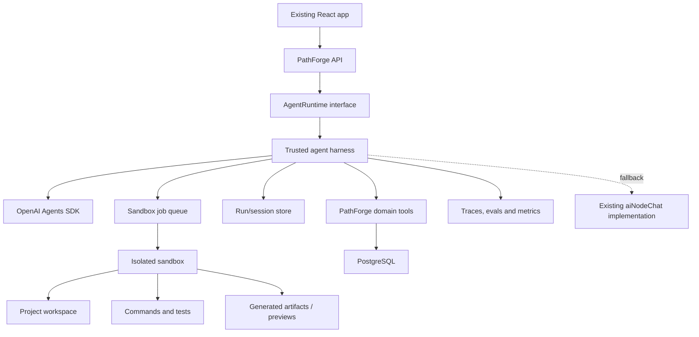

You are now cleanly positioned on `codex/buildweek`, which points at the committed baseline. The safest strategy is:

1. Build and evaluate the harness independently.
2. Integrate it behind a stable interface and feature flag.
3. Move sandbox execution to managed infrastructure.
4. Gradually replace the current AI implementation while retaining rollback.

The important design choice: not every tutor message needs a sandbox. Use a normal agent runtime for conversation and orchestration, and invoke a sandbox agent only when the learner needs code execution, file manipulation, validation, previews, or persistent workspace work.

## Target architecture



The harness is the trusted control plane. It owns authentication, model calls, tool routing, approvals, database access, run state and audit logs. The sandbox is an untrusted execution plane containing only scoped project files and commands. This separation matches OpenAI’s recommended Sandbox Agent architecture. [Sandbox Agents documentation](https://developers.openai.com/api/docs/guides/agents/sandboxes)

# Stage 1: Build the harness lab

## 1. Create a separate workspace

Start with:

```text
artifacts/agent-runtime/
├── src/
│   ├── agents/
│   │   ├── tutor-agent.ts
│   │   └── workspace-agent.ts
│   ├── runtime/
│   │   ├── agent-runtime.ts
│   │   ├── openai-runtime.ts
│   │   ├── legacy-runtime.ts
│   │   └── events.ts
│   ├── sandbox/
│   │   ├── manifest.ts
│   │   ├── docker-provider.ts
│   │   └── policies.ts
│   ├── tools/
│   │   ├── get-learning-context.ts
│   │   ├── propose-node-update.ts
│   │   ├── validate-dag.ts
│   │   ├── run-project-check.ts
│   │   └── request-approval.ts
│   ├── state/
│   │   └── session-store.ts
│   └── evals/
│       ├── fixtures/
│       ├── graders/
│       └── run-suite.ts
└── package.json
```

Keep this package independent of Express and React. It should accept typed input and emit typed events.

## 2. Define the integration contract first

```ts
export interface AgentRuntime {
  runTurn(input: AgentTurnInput): AsyncIterable<AgentEvent>;

  resume(
    runId: string,
    decision: ApprovalDecision,
  ): AsyncIterable<AgentEvent>;

  cancel(runId: string): Promise<void>;
}

export type AgentEvent =
  | { type: "text_delta"; content: string }
  | { type: "tool_started"; tool: string }
  | { type: "tool_completed"; tool: string; summary: string }
  | { type: "plan_patch_proposed"; patch: LearningPlanPatch }
  | { type: "artifact_created"; artifactId: string }
  | { type: "approval_required"; approvalId: string; description: string }
  | { type: "completed"; result: AgentResult }
  | { type: "failed"; code: string; message: string };
```

This prevents your routes and frontend from becoming coupled to OpenAI, Docker, or a particular sandbox provider.

Implement two adapters:

```text
LegacyAgentRuntime  → wraps the existing aiNodeChat functions
OpenAIAgentRuntime → new Agents SDK harness
```

That gives you immediate fallback and side-by-side comparison.

## 3. Split the agents by responsibility

### Tutor agent

Runs for most chat turns. It can:

- Explain concepts
- Inspect the current node and learner profile
- Update session steps
- Propose learning-plan changes
- Request a sandbox task
- Ask for approval

It should not have shell or filesystem access.

### Workspace agent

A `SandboxAgent` invoked only when necessary:

- Run learner code
- Inspect multiple project files
- Execute tests or linters
- Generate an artifact
- Serve a preview
- Verify that a technical step actually works

OpenAI’s SDK supports composing sandbox agents through handoffs or as tools, while keeping the top-level harness outside the sandbox. [Sandbox composition guidance](https://developers.openai.com/api/docs/guides/agents/sandboxes)

## 4. Replace prompt markers with typed tools

The existing harness encodes control actions inside text markers such as `[STEP_DETAIL]`, `[STEPS_UPDATE]`, spawn commands and regeneration commands.

Migrate those concepts as follows:

| Existing behavior | New harness behavior |
|---|---|
| `[STEPS_UPDATE]` text parsing | `update_session_steps` tool |
| Spawn markers | `propose_extra_node` tool |
| Plan regeneration marker | `propose_plan_revision` tool |
| Code-context extraction | Workspace artifact/context reducer |
| Post-response parsing | Typed event reducer |
| Direct DB mutation | Validated domain-tool handler |
| Custom OpenRouter stream | `AgentEvent` stream |

Tool handlers should use Zod schemas and return structured results. The model proposes an action; trusted application code validates ownership, DAG correctness and allowed state transitions before modifying PostgreSQL.

## 5. Run Docker locally

Use Docker Desktop for BuildWeek. Each eval case should receive a fresh container containing:

```text
/workspace/
├── input/
│   ├── task.md
│   ├── learner-profile.json
│   ├── project.json
│   └── node-map.json
├── project/
└── output/
```

Recommended policy:

- `input/` read-only
- `project/` scoped to that test project
- `output/` writable
- Network disabled by default
- No database or model API key
- Non-root user
- CPU, memory, process, disk and time limits
- Container destroyed after the run
- Only reviewed artifacts exported

The SDK supports manifests, files, repositories, environment configuration, commands, ports, session state and snapshots. It also lets you keep the agent definition stable while replacing Docker with a hosted provider later. [Sandbox workspace and provider documentation](https://developers.openai.com/api/docs/guides/agents/sandboxes)

## 6. Build the evaluation harness immediately

Convert [AIExperience](</C:/Users/nguye/OneDrive - National University of Singapore/ForgePath/Tech-Path-Finder/AIExperience/README.md:1>) into replayable scenarios.

Each case should include:

```ts
interface EvalCase {
  name: string;
  profile: LearnerProfile;
  project: Project;
  nodeMap: NodeMap;
  conversation: Message[];
  sandboxFixture?: string;
  expected: {
    requiredBehaviors: string[];
    forbiddenBehaviors: string[];
    expectedTools?: string[];
    maximumToolCalls?: number;
  };
}
```

Measure:

- Learning correctness
- Instruction consistency
- Tool selection
- Tool-call efficiency
- Whether claims are supported by sandbox evidence
- DAG validity
- Recovery from tool errors
- Approval behavior
- Sandbox-policy violations
- Latency, tokens and cost
- Legacy-versus-new quality

OpenAI recommends inspecting traces first, then converting stable expectations into datasets and repeatable evals. [Agent evaluation guidance](https://developers.openai.com/api/docs/guides/agent-evals) Tracing is enabled by default in the normal server-side Agents SDK path and records model calls, tools, handoffs and guardrails. [Observability documentation](https://developers.openai.com/api/docs/guides/agents/integrations-observability)

# Stage 2: Integrate it into PathForge

## Multi-runtime environment resolution and caching

BuildWeek proves this architecture with Node first; it does not attempt to support every
toolchain at once.

```text
Project manifests
  → RuntimeDetector
  → typed RuntimePlan
  → RuntimePolicy
  → trusted environment builder
  → content-addressed dependency cache
  → disposable execution sandbox
```

Keep three layers separate:

1. Runtime image, keyed by the pinned base-image digest and runtime tooling.
2. Dependency cache, keyed by the runtime image, lockfile, workspace manifests and patches.
3. Fresh filtered source snapshot, created for every run and destroyed afterward.

Implementation order:

1. Cache locked Node dependencies while keeping lifecycle scripts disabled.
2. Extract the Node-specific behavior behind `RuntimeDetector`, `RuntimePlan` and
   `RuntimePolicy` interfaces.
3. Add Python as the second ecosystem proof.
4. Add Java after the resolver and cache contracts are stable.
5. Treat ROS 2, Dev Containers and project Dockerfiles as specialized environment
   proposals requiring stricter policy and, when unfamiliar, user approval.
6. In production, separate the networked environment builder from the non-networked,
   non-root execution sandbox.

Never automatically build an unreviewed project Dockerfile or run an arbitrary registry
image. Prefer a trusted catalog, immutable image digests and an explicit unsupported result
for hardware, licensed software or privileged-device requirements.

## 1. Add a composition layer

The current route directly imports:

- `streamNodeChatMessage`
- `streamOpeningMessage`
- `streamStepDetail`
- `generateNodeMap`
- `streamVisualization`

Instead, routes should depend on a runtime selected at startup:

```ts
const agentRuntime: AgentRuntime =
  process.env.AGENT_RUNTIME === "openai"
    ? createOpenAIAgentRuntime()
    : createLegacyAgentRuntime();
```

Do not rewrite the frontend initially. Add an adapter translating `AgentEvent` into the current SSE protocol.

```text
AgentEvent.text_delta       → existing chunk event
AgentEvent.completed        → existing done event
AgentEvent.artifact_created → visualization/artifact event
AgentEvent.failed           → error event
```

## 2. Introduce new API endpoints only where necessary

For ordinary chat, keep the existing endpoint:

```text
POST /projects/:projectId/nodes/:nodeId/chat
```

For longer or resumable work, add:

```text
POST /agent-runs
GET  /agent-runs/:runId
GET  /agent-runs/:runId/events
POST /agent-runs/:runId/approve
POST /agent-runs/:runId/cancel
GET  /agent-runs/:runId/artifacts
```

Long-running sandbox tasks should not depend on one HTTP connection remaining open. The API creates a run, a worker processes it, and the frontend reconnects to the event stream.

## 3. Keep three state layers separate

| State | Storage |
|---|---|
| Conversation and tool history | SDK session plus PostgreSQL |
| Harness run and approvals | PostgreSQL |
| Live sandbox | Sandbox provider |
| Files and generated artifacts | Object storage |
| Reusable workspace baseline | Sandbox snapshot or object storage |

OpenAI distinguishes run state, live sandbox-session state and snapshots. SDK sessions are the sensible default for durable application-controlled conversations and resumable approvals. [Running Agents documentation](https://developers.openai.com/api/docs/guides/agents/running-agents)

Suggested new tables:

```text
agent_runs
agent_run_events
agent_approvals
agent_artifacts
sandbox_sessions
agent_eval_results
prompt_versions
```

Do not store large artifacts or snapshots directly in PostgreSQL; store object keys and metadata.

## 4. Roll out through three modes

### Offline mode

Only eval fixtures. No user traffic.

### Shadow mode

The legacy system responds to the user. The new runtime receives a copy of sanitized input, but its result is recorded only for comparison.

Never allow shadow runs to mutate the database.

### Cohort mode

Enable the new runtime for selected internal users or projects:

```text
AGENT_RUNTIME_MODE=cohort
AGENT_RUNTIME_ALLOWLIST=...
```

Then progress through controlled percentages while retaining instant fallback to `LegacyAgentRuntime`.

# Stage 3: Make it production-ready

## 1. Separate web API from agent workers

The Render API should remain the control plane:

```text
Render API
  → creates agent run
  → enqueues job
  → streams stored events
```

A separate worker should:

```text
Worker
  → claims run
  → calls Agents SDK
  → starts hosted sandbox when needed
  → persists events/results
  → cleans up sandbox
```

Use a durable queue with retry and lease semantics. PostgreSQL-backed jobs are sufficient initially; Redis becomes useful if concurrency and event throughput grow.

Nested Docker is unlikely to be an appropriate production dependency for the current Render web service. Keep Docker for local development and choose a hosted sandbox provider behind your `SandboxProvider` interface for production. The Agents SDK currently documents providers including Cloudflare, Daytona, E2B, Modal, Runloop, Vercel and others. Benchmark them for startup time, isolation, region, snapshots, preview URLs and cost before choosing. [Sandbox provider list](https://developers.openai.com/api/docs/guides/agents/sandboxes)

## 2. Add production execution controls

Every run needs:

- Idempotency key
- Maximum agent turns
- Maximum tool calls
- Token and monetary budget
- Wall-clock deadline
- Sandbox CPU/memory/disk limits
- Network egress policy
- Retry classification
- Cancellation support
- Heartbeats and abandoned-run recovery
- Per-user concurrency limit
- Per-user daily usage limit
- Artifact retention policy
- Complete audit trail

A worker crash must leave the run resumable or clearly failed, never silently “running” forever.

## 3. Treat the sandbox as hostile

The sandbox must never receive:

- `DATABASE_URL`
- Clerk secret keys
- OpenAI API key
- unrestricted storage credentials
- another learner’s files
- production service tokens

When a sandbox needs an external resource, use a short-lived, narrowly scoped token issued by the harness. Validate every artifact before exposing it to the user.

Database writes happen through trusted tools outside the sandbox:

```text
Sandbox proposes result
  → harness parses result
  → Zod validation
  → authorization check
  → DAG/business-rule validation
  → transaction
  → audit event
```

## 4. Version everything

Record with every run:

- Agent definition version
- Prompt version
- Tool schema version
- Model and settings
- Sandbox image digest
- Input fixture/context hash
- Runtime version
- Trace ID
- Result and grader scores

This lets you reproduce regressions instead of guessing which prompt or tool changed behavior.

## 5. Establish release gates

Do not promote a harness revision based on a few good chats. Require:

- No critical sandbox-policy violations
- No unauthorized mutation attempts
- Better or equal eval score than the legacy runtime
- Passing DAG/state-transition validation
- Reliable cancellation and timeout behavior
- Successful recovery from worker termination
- Acceptable p50/p95 latency
- Known average cost per learning session
- Human review of representative traces
- Successful shadow comparison on real traffic

## Practical implementation order

I would execute the branch in this sequence:

1. Create `artifacts/agent-runtime`.
2. Define `AgentRuntime`, `AgentEvent` and typed domain results.
3. Wrap the current implementation as `LegacyAgentRuntime`.
4. Create one OpenAI tutor agent without a sandbox.
5. Replace one marker protocol with one typed tool.
6. Add the Docker workspace agent.
7. Convert the three `AIExperience` reports into evals.
8. Add trace and cost reporting.
9. Integrate the event adapter into only the chat endpoint.
10. Run shadow mode.
11. Add persistent runs, approvals and artifacts.
12. Select a hosted sandbox provider.
13. Deploy a separate worker.
14. Roll out by cohort with legacy fallback.
15. Remove legacy prompt parsing only after the new runtime clears the release gates.

The best BuildWeek demo is not merely “the AI can run commands.” It is: a learner asks for help, the tutor recognizes that execution is needed, delegates to an isolated workspace, runs or tests the project, returns evidence, updates the learning path through validated tools, and shows a complete trace plus an eval improvement over the old harness.
