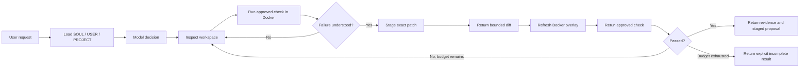

# Packaged Coding Agent Process

This document defines the reusable process proven by the BuildWeek lab. It is the
behavioral package to preserve while integrating the agent into another application.

## Public boundary

The application supplies a typed turn and consumes typed events:

```ts
interface AgentRuntime {
  runTurn(input: AgentTurnInput): AsyncIterable<AgentEvent>;
  cancel(runId: string): Promise<void>;
}
```

The application should not import Docker, OpenRouter or individual tools directly.
Those are internal harness details.

## One coding turn



## Trust boundaries

### Trusted control plane

- Model invocation and tool routing
- Runtime and command policy
- User/workspace authorization
- Run budgets and cancellation
- Staged-edit limits
- Approval and audit state

### Untrusted execution plane

- Project source
- Dependency packages
- Test and build processes
- Generated command output

The execution plane receives no application secrets or database credentials.

## Runtime resolution

```text
Known manifests
  → RuntimeDetector
  → typed RuntimePlan
  → deterministic RuntimePolicy
  → trusted base image
  → dependency cache
  → disposable source sandbox
```

Supported proofs:

| Ecosystem | Dependency input | Execution |
|---|---|---|
| Node 24 | pnpm/npm lockfile | package test, typecheck and build scripts |
| Python 3.13 | uv.lock | exact uv offline recipes |
| Python 3.13 | pinned requirements.txt | exact Python module recipes |

Unknown environments return an explicit unsupported result. They are never converted
into arbitrary Dockerfile builds.

## Dependency preparation

Loose `requirements.in` or `requirements.txt` input is validated before resolution.
A temporary restricted container may use network access to create a complete,
hash-locked proposal. That proposal is staged, never written to the real workspace.

Normal execution then:

1. hashes the runtime plan and dependency manifests;
2. restores or builds a dependency image;
3. disconnects networking;
4. overlays filtered source and staged edits;
5. runs an exact allowlisted command;
6. destroys the session container.

## Editing contract

`apply_patch` stages one exact replacement:

```json
{
  "path": "src/example.ts",
  "oldText": "const value = 1;",
  "newText": "const value = 2;"
}
```

For a new file, `oldText` is `null`.

Current limits:

- 10 staged files
- 500 changed lines
- 200,000 characters per file
- one unique exact-context replacement per call
- no binary or symlink targets
- no traversal or Windows device/alternate-stream paths
- secrets, agent identity files and repository metadata are protected

The result must include a bounded diff and state that the host workspace was unchanged.

## Repair-loop controls

The harness versions tool evidence. An identical command is rejected when nothing has
changed, preventing repeated-tool loops. A successful staged edit advances the evidence
revision, allowing the same test command to run again against the new overlay.

Repair is bounded twice:

- `ApplyPatchTool` limits staged repair attempts per run.
- Harness turn, tool-call, tool-time and total-run budgets provide hard outer limits.

The verified Docker scenario reads a bug, proves the original test failure, stages one
exact fix, refreshes the disposable sandbox, reruns the identical test successfully,
and confirms the host source remains unchanged.

## Application integration checklist

- Depend on `AgentRuntime`, not concrete model or sandbox classes.
- Translate typed events at the API boundary.
- Persist runs and approvals separately from conversations.
- Keep staged content separate from user files.
- Require explicit authorization before applying a staged proposal.
- Record model, prompt, tool schema, runtime plan and image versions.
- Preserve cancellation, budgets and cleanup during disconnects.
- Keep legacy fallback until shadow and cohort evaluations pass.

## Verification

```bash
# No Docker required
pnpm run agent:verify

# Docker Desktop and local images required
pnpm run agent:verify:docker
```

The Docker suite is intentionally separate because dependency installation and the
Electron UI journey are slower than the deterministic harness checks.
